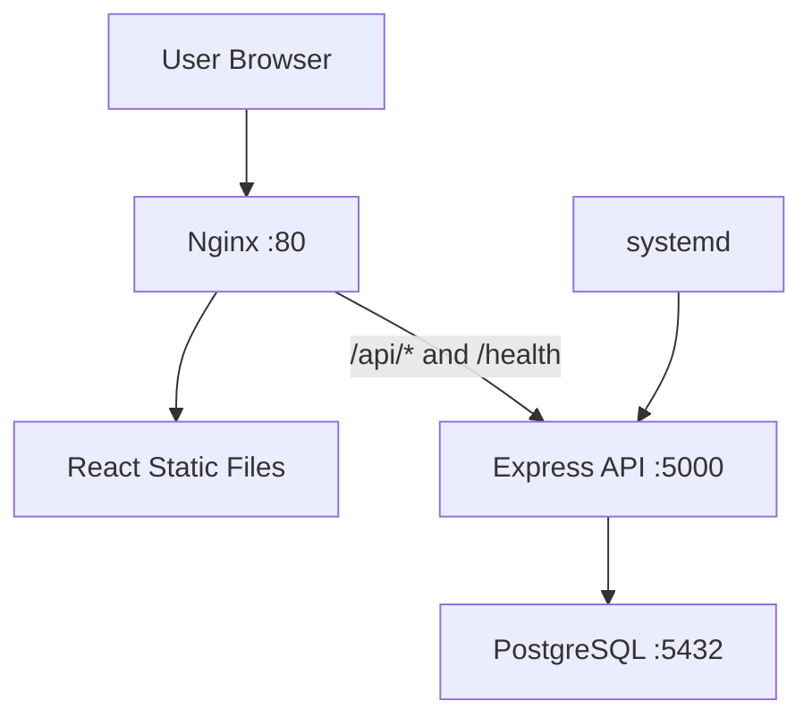
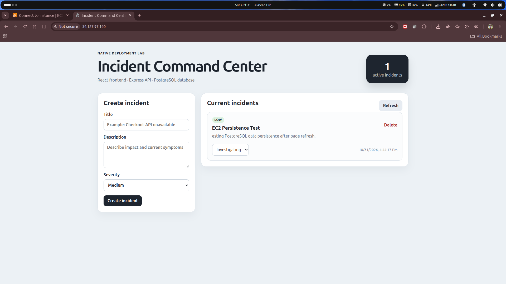
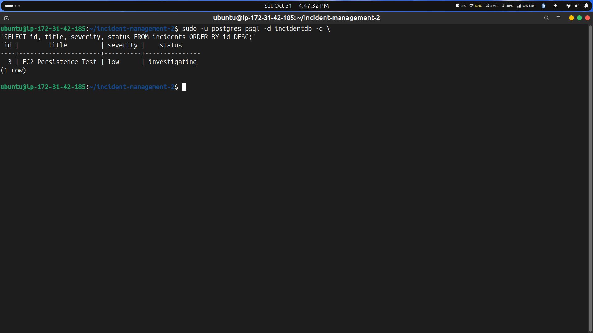
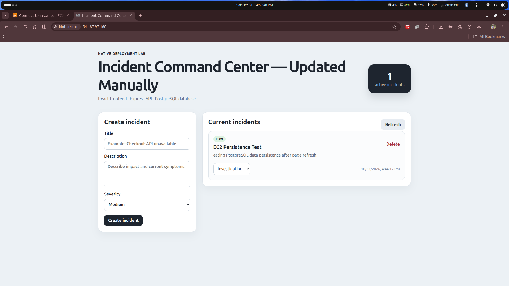
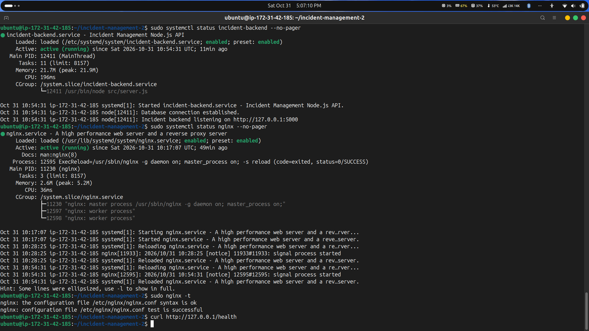
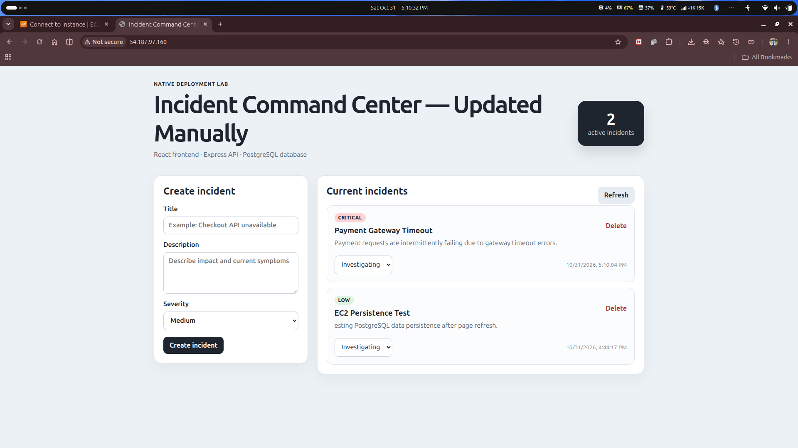
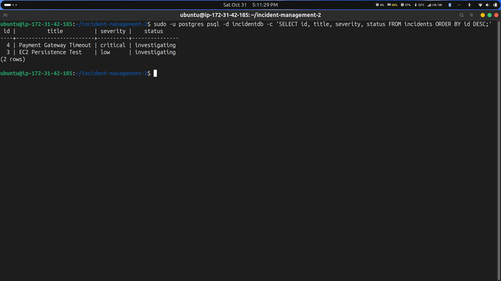

# bongoDev Incident Management

<p align="center">
  
  
  
  
  
  
</p>

<p align="center">
  A full-stack incident management application deployed on AWS EC2 with Ubuntu, Nginx, Node.js, Express, and PostgreSQL — without Docker.
</p>

---

## Project Overview

**bongoDev Incident Management** is a hands-on deployment project that demonstrates how to run a React and Express application on an Ubuntu Server 24.04 LTS EC2 instance.

The React frontend is built with Vite and served by Nginx. Nginx also acts as a reverse proxy for the Express REST API. The backend runs as a systemd service and stores incident records in PostgreSQL.

The main deployment was completed manually using Bash scripts. An optional GitHub Actions workflow is included to demonstrate how build checks and deployment to an existing EC2 instance can be automated.

## Features

- Create and manage incident records.
- Update incident statuses.
- Store incident data in PostgreSQL.
- Preserve incident records across application redeployments.
- Serve the React frontend through Nginx.
- Route API requests through an Nginx reverse proxy.
- Manage the backend process with systemd.
- Automate server setup, database configuration, deployment, and checks with Bash scripts.
- Include an optional GitHub Actions CI/CD workflow.

## Technology Stack

| Category | Technologies |
|---|---|
| Cloud | AWS EC2 |
| Operating System | Ubuntu Server 24.04 LTS |
| Frontend | React, Vite |
| Backend | Node.js 24, Express.js |
| Database | PostgreSQL 16 |
| Web Server / Reverse Proxy | Nginx |
| Process Management | systemd |
| Scripting | Bash |
| CI/CD | GitHub Actions |

## Architecture



### Request Flow

1. The browser sends a request to the EC2 instance through HTTP.
2. Nginx serves the built React frontend.
3. Requests to `/api/*` and `/health` are proxied to the Express backend on `127.0.0.1:5000`.
4. The backend communicates with PostgreSQL on `127.0.0.1:5432`.
5. systemd manages the backend service.

## Repository Structure

```text
incident-management-2/
├── .github/
│   └── workflows/
│       └── deploy.yml
├── backend/
│   ├── src/
│   │   ├── db.js
│   │   └── server.js
│   ├── .env.example
│   ├── package.json
│   └── package-lock.json
├── deploy/
│   └── nginx-incident-management.conf
├── docs/
│   └── GITHUB_ACTIONS.md
├── frontend/
│   ├── src/
│   │   ├── main.jsx
│   │   └── styles.css
│   ├── index.html
│   ├── package.json
│   ├── package-lock.json
│   └── vite.config.js
├── incident-management-submission/
│   ├── 01-ec2-running.png
│   ├── 02-installed-technologies.png
│   ├── 03-backend-health.png
│   ├── 04-live-application.png
│   ├── 05-incident-persistence.png
│   └── 06-postgresql-records.png
├── scripts/
│   ├── check-services.sh
│   ├── deploy-ubuntu.sh
│   ├── install-dependencies.sh
│   ├── install-nginx-ubuntu.sh
│   ├── install-nodejs-ubuntu.sh
│   ├── install-postgresql-ubuntu.sh
│   ├── install-ubuntu.sh
│   ├── setup-database.sh
│   └── verify.sh
├── .gitignore
├── .nvmrc
└── README.md
```

## Deployment on AWS EC2

### 1. Launch an EC2 Instance

Launch an EC2 instance using **Ubuntu Server 24.04 LTS**.

Configure the security group to:
- Allow HTTP traffic on port `80`.
- Allow SSH on port `22` only from your trusted IP address.
- Keep backend port `5000` and PostgreSQL port `5432` private.

### 2. Connect to the Instance

```bash
ssh -i your-key.pem ubuntu@YOUR_EC2_PUBLIC_IP
```

### 3. Clone the Repository

```bash
git clone https://github.com/tanahmeeedsx/incident-management-2.git
cd incident-management-2
```

### 4. Install Server Dependencies

```bash
chmod +x scripts/*.sh
bash scripts/install-ubuntu.sh
```

### 5. Configure PostgreSQL

```bash
bash scripts/setup-database.sh
```

The setup script prepares the application database and backend environment configuration. The generated `backend/.env` file contains private database credentials and must remain untracked.

### 6. Deploy the Application

```bash
bash scripts/deploy-ubuntu.sh
```

The deployment script installs application dependencies, builds the frontend, configures the backend systemd service, installs the Nginx configuration, and checks application health.

### 7. Check Services

```bash
bash scripts/check-services.sh
```

Open the application in your browser:

```text
http://YOUR_EC2_PUBLIC_IP
```

## Verification

Check the backend service:

```bash
sudo systemctl status incident-backend
```

Check the health endpoint through Nginx:

```bash
curl http://127.0.0.1/health
```

A healthy response should report that the service is healthy and the database is connected:

```json
{
  "service": "incident-backend",
  "status": "healthy",
  "database": "connected"
}
```

Check the incidents API:

```bash
curl http://127.0.0.1/api/incidents
```

Create an incident, update its status, and refresh the application to verify that the records persist.

## Manual Redeployment

This project also demonstrates updating the application without recreating the database.

1. Make a frontend change, such as updating the heading in `frontend/src/main.jsx`.
2. Run the deployment script again:

   ```bash
   bash scripts/deploy-ubuntu.sh
   ```

3. Refresh the application and verify the updated interface.
4. Confirm that existing incident records remain available.

The submitted deployment includes the manually updated heading **Incident Command Center — Updated Manually**.

## Deployment Screenshots

### 1. EC2 Instance Running



### 2. Installed Technologies



### 3. Backend Health Check



### 4. Live Application



### 5. Incident Creation and Persistence



### 6. PostgreSQL Records



## Challenges and Solutions

| Challenge | Solution |
|---|---|
| Preparing the Ubuntu server | Used Bash scripts to install and configure the required packages. |
| Keeping database credentials private | Stored credentials in `backend/.env` and excluded the file from Git. |
| Serving the frontend and API together | Configured Nginx to serve static frontend files and proxy API requests. |
| Keeping the backend process running | Configured the Express backend as a systemd service. |
| Preserving incident data | Used PostgreSQL for persistent storage. |
| Repeating deployment steps consistently | Created a deployment script to build and configure the application. |

## Optional CI/CD with GitHub Actions

The repository includes `.github/workflows/deploy.yml` for an optional CI/CD workflow.

The workflow is designed to:

- Run backend validation checks.
- Install frontend dependencies and build the React application.
- Deploy to an already configured Ubuntu EC2 instance when the required repository variables and secrets are provided.

The workflow does not create or provision EC2 infrastructure. The main application deployment demonstrated in this project was performed manually.

See [GitHub Actions Documentation](docs/GITHUB_ACTIONS.md) for configuration details.

## Security Notes

- Restrict SSH access to trusted IP addresses.
- Expose application traffic through Nginx on port `80`.
- Do not expose PostgreSQL port `5432` or backend port `5000` publicly.
- Never commit `backend/.env`, database passwords, or SSH private keys.
- Use GitHub Secrets for sensitive CI/CD configuration.
- This educational demo does not include authentication and uses HTTP. Do not use it for sensitive incident data.

## Future Improvements

- Add authentication and role-based access control.
- Introduce incident priority, assignment, and filtering.
- Configure HTTPS with SSL/TLS.
- Add monitoring, centralized logging, and alerting.
- Expand automated testing and CI/CD checks.
- Provision infrastructure using Infrastructure as Code.

## What I Learned

- Launching and configuring an Ubuntu EC2 instance.
- Installing and managing Node.js, PostgreSQL, and Nginx.
- Deploying a React and Express application without containers.
- Configuring Nginx as a reverse proxy.
- Managing backend processes with systemd.
- Handling environment variables and persistent database records.
- Automating server setup and deployment tasks with Bash.
- Understanding how GitHub Actions can support CI/CD.

## Author

**Tanjim Ahmed (Tomal)**

- GitHub: [@tanahmeeedsx](https://github.com/tanahmeeedsx)

---

<p align="center">
  Built as part of the bongoDev Student Lab — Manual Deployment of Incident Management on Ubuntu EC2.
</p>
